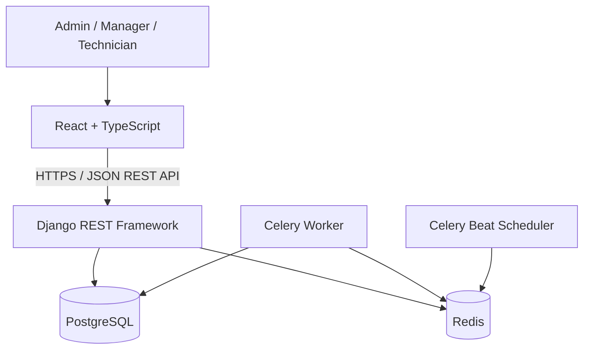

# MaintenX

A multi-organization equipment maintenance management platform for small and medium-sized manufacturers, workshops, and industrial facilities.

> **Status:** 🚧 In development — 7-day MVP build. See [Progress](#progress) for the current phase.

## Table of contents

- [Overview](#overview)
- [Features](#features)
- [Roles](#roles)
- [Tech stack](#tech-stack)
- [Architecture](#architecture)
- [Project structure](#project-structure)
- [Getting started](#getting-started)
- [Environment variables](#environment-variables)
- [Testing](#testing)
- [Documentation](#documentation)
- [Progress](#progress)
- [Known limitations](#known-limitations)
- [Roadmap](#roadmap)

## Overview

Maintenance information is often scattered across spreadsheets, paper forms, chat apps, and individual employees' memory. That makes it hard to answer basic questions:

- Which equipment do we have, and where is it?
- Which preventive maintenance tasks are due or overdue?
- Who is responsible for an active repair?
- How long was a machine unavailable?
- Which equipment breaks down repeatedly?

MaintenX is a single system of record for these activities. It is a focused MVP that demonstrates a realistic business workflow and sound engineering practices, not a replacement for a full enterprise CMMS.

> The problems above are the ones the product is designed to address. They should be validated with real maintenance managers and technicians before being treated as proven needs.

## Features

The MVP covers six areas. Items are implemented phase by phase (see [Progress](#progress)).

| Area                               | What it does                                                                                                      |
| ---------------------------------- | ----------------------------------------------------------------------------------------------------------------- |
| **Authentication & organizations** | JWT login, token refresh, current-user profile, admin-managed users, strict organization-level data isolation     |
| **Equipment**                      | Equipment register with search, filters, pagination, history, and retirement (no hard deletes)                    |
| **Preventive maintenance**         | Daily/weekly/monthly plans, upcoming/due/overdue views, automatic daily work-order generation (idempotent)        |
| **Work orders**                    | Create, assign, start, complete, cancel; server-enforced state machine; full activity timeline                    |
| **Downtime tracking**              | Record breakdowns and recoveries; duration calculated server-side; no overlapping open incidents                  |
| **Dashboard & analytics**          | Real-database KPIs: downtime, MTTR, MTBF (estimated), preventive maintenance completion rate, charts and rankings |

**Work-order workflow**

```text
OPEN → ASSIGNED → IN_PROGRESS → COMPLETED
OPEN / ASSIGNED → CANCELLED
```

`COMPLETED` and `CANCELLED` are terminal states.

**Out of scope for the MVP:** IoT/telemetry, AI failure prediction, native mobile apps, WebSockets, spare-parts inventory, approval chains, billing, ERP integrations, offline mode.

## Roles

Each user belongs to exactly one organization.

| Capability                               | Admin | Manager |  Technician   |
| ---------------------------------------- | :---: | :-----: | :-----------: |
| Manage organization users                |  ✅   |    —    |       —       |
| Create/edit equipment                    |  ✅   |   ✅    |       —       |
| View equipment and maintenance plans     |  ✅   |   ✅    |      ✅       |
| Create maintenance plans and work orders |  ✅   |   ✅    |       —       |
| Assign technicians                       |  ✅   |   ✅    |       —       |
| Start/complete work orders               |  ✅   |   ✅    | Assigned only |
| Record downtime                          |  ✅   |   ✅    |      ✅       |
| View analytics                           |  ✅   |   ✅    |       —       |

Permissions are enforced by the backend. Hiding a button in the UI is not security.

## Tech stack

| Layer              | Technology                                                                 |
| ------------------ | -------------------------------------------------------------------------- |
| Backend            | Python, Django, Django REST Framework                                      |
| Auth               | JWT (`djangorestframework-simplejwt`)                                      |
| API docs           | OpenAPI / Swagger (`drf-spectacular`)                                      |
| Database           | PostgreSQL 16                                                              |
| Background jobs    | Celery + Redis                                                             |
| Frontend           | React, TypeScript, Vite                                                    |
| Frontend libraries | TanStack Query, React Router, React Hook Form, Zod, Recharts, Tailwind CSS |
| Testing            | pytest, pytest-django                                                      |
| Infrastructure     | Docker Compose                                                             |

## Architecture

MaintenX is a **modular monolith**: one Django project, one PostgreSQL database, and one app per business capability. There are no microservices.



Key principles:

- **The organization is the tenant boundary.** It is always derived from the authenticated user, never from client input, and every queryset is scoped to it.
- **Thin views, explicit services.** Business rules live in `services.py`; multi-record writes use transactions.
- **Server-side state machine.** Work-order status changes go through dedicated action endpoints, not generic updates.
- **Idempotent scheduling.** A database unique constraint prevents duplicate work orders for the same plan occurrence.
- **Analytics from the database.** KPIs use ORM aggregation with documented formulas and return sample counts.

Details: [docs/architecture.md](docs/architecture.md).

## Project structure

```text
maintenx/
├── backend/
│   ├── config/            # Django project (settings, urls, celery)
│   ├── accounts/          # Organization, User, auth
│   ├── equipment/         # Categories and equipment
│   ├── maintenance/       # Maintenance plans, scheduling, Celery tasks
│   ├── workorders/        # Work orders and history
│   ├── downtime/          # Breakdown and recovery records
│   ├── analytics/         # KPI queries (no models)
│   ├── core/              # Shared permissions, pagination, audit log
│   ├── conftest.py        # Shared test fixtures
│   ├── manage.py
│   └── requirements.txt
├── frontend/
│   └── src/
│       ├── api/           # API client and per-resource functions
│       ├── components/    # Layout and reusable UI
│       ├── pages/         # One folder/file per page
│       ├── hooks/
│       └── types/
├── docs/                  # Specification, architecture, database design, API guide
├── docker-compose.yml     # PostgreSQL and Redis for local development
├── .env.example
└── README.md
```

Each backend app follows the same layout: `models.py`, `serializers.py`, `views.py`, `urls.py`, optional `services.py`, and a `tests/` folder.

## Getting started

### Prerequisites

- Python 3.12 (3.10+ should work)
- Node.js 20+ and npm
- Docker Desktop (for PostgreSQL and Redis)
- Git

### 1. Clone and configure

```bash
git clone <repository-url>
cd maintenx
cp .env.example .env        # Windows PowerShell: Copy-Item .env.example .env
```

Edit `.env` and set real values for `DJANGO_SECRET_KEY` and `POSTGRES_PASSWORD`. Never commit `.env`.

### 2. Start PostgreSQL and Redis

```bash
docker compose up -d
docker compose ps           # db should be "healthy", redis "running"
```

If a port is already in use on your machine, change `POSTGRES_PORT` or `REDIS_PORT` in `.env`. Both Docker Compose and Django read the same values.

### 3. Backend

```bash
cd backend
python -m venv .venv

# Activate the virtual environment
#   Windows PowerShell:  .venv\Scripts\Activate.ps1
#   Windows Git Bash:    source .venv/Scripts/activate
#   macOS / Linux:       source .venv/bin/activate

pip install -r requirements.txt
python manage.py check
python manage.py runserver  # http://localhost:8000
```

Database migrations, demo data, and API docs become available as the project progresses:

```bash
# From Phase 1
python manage.py migrate

# From Phase 7
python manage.py seed_demo_data
```

### 4. Frontend

```bash
cd frontend
npm install
npm run dev                 # http://localhost:5173
```

Use `npm ci` instead of `npm install` in CI and Docker builds so the installed versions match `package-lock.json` exactly.

## Environment variables

Defined in `.env` (template: `.env.example`).

| Variable               | Description                                                                        |
| ---------------------- | ---------------------------------------------------------------------------------- |
| `DJANGO_SECRET_KEY`    | Django secret key. Use a long random value.                                        |
| `DJANGO_DEBUG`         | `True` for local development only.                                                 |
| `DJANGO_ALLOWED_HOSTS` | Comma-separated allowed hosts.                                                     |
| `POSTGRES_DB`          | Database name.                                                                     |
| `POSTGRES_USER`        | Database user.                                                                     |
| `POSTGRES_PASSWORD`    | Database password.                                                                 |
| `POSTGRES_HOST`        | `localhost` when Django runs on the host; `db` when it runs inside Docker Compose. |
| `POSTGRES_PORT`        | Host port mapped to PostgreSQL's port 5432 inside the container.                   |
| `REDIS_PORT`           | Host port mapped to Redis's port 6379 inside the container.                        |
| `REDIS_URL`            | Redis connection URL used by Celery. Must match `REDIS_PORT`.                      |
| `CORS_ALLOWED_ORIGINS` | Allowed frontend origin(s).                                                        |
| `TIME_ZONE`            | Default time zone (`Asia/Jakarta` for the demo organization).                      |

## Testing

```bash
# Backend (from backend/)
pytest
python manage.py check
python manage.py makemigrations --check --dry-run

# Frontend (from frontend/)
npm run build
```

Test priorities: authentication, organization data isolation for every resource, role and object-level permissions, recurrence and idempotency, work-order transitions, downtime validation, and KPI calculations.

## Documentation

| Document                                                        | Contents                                                       |
| --------------------------------------------------------------- | -------------------------------------------------------------- |
| [Project specification](docs/MaintenX_Project_Specification.md) | Product scope, requirements, phases, acceptance criteria       |
| [Architecture](docs/architecture.md)                            | Modules, request flow, tenant isolation, background jobs       |
| [Database design](docs/database-design.md)                      | Tables, constraints, enums, KPI data requirements              |
| [API guide](docs/api-guide.md)                                  | Endpoints, roles, request/response examples, error conventions |

Interactive API documentation (Swagger UI) will be linked here once the API is available.

## Progress

| Phase | Scope                                                            | Status     |
| ----- | ---------------------------------------------------------------- | ---------- |
| 0     | Environment setup, project initialization                        | ✅ Done    |
| 1     | Backend foundation, data model, authentication, tenant isolation | ✅ Done    |
| 2     | Equipment management                                             | ⬜ Next    |
| 3     | Preventive maintenance scheduling (Celery)                       | ⬜ Planned |
| 4     | Work-order workflow                                              | ⬜ Planned |
| 5     | Downtime tracking and analytics                                  | ⬜ Planned |
| 6     | Integration, testing, hardening                                  | ⬜ Planned |
| 7     | Docker, deployment, seed data, documentation, demo               | ⬜ Planned |

### Progress log

Newest first. Add an entry at the end of each phase.

- **2026-11-03 — Phase 0 complete.** Django project and seven apps created, React + TypeScript + Vite + Tailwind initialized, PostgreSQL and Redis running in Docker Compose, project documentation added.
- **2026-11-04 — Phase 1 complete.** Settings read from `.env`; custom `Organization` and `User` models; JWT login, refresh rotation with blacklist, logout, and `/auth/me/`; admin user management and `/users/technicians/`; organization-scoped queryset mixin and role permissions in `core/`; Swagger UI at `/api/v1/docs/`; 44 tests covering auth, permissions, and cross-organization isolation.

## Known limitations

- Each user belongs to one organization (no multi-organization membership).
- Recurrence supports daily, weekly, and monthly only; no custom schedules or holiday calendars.
- MTBF is an estimate based on a configurable assumed operating-hours value, not sensor data.
- No notifications, attachments, or exports yet.

_This section will be updated as the implementation reveals more._

## Roadmap

After the MVP is complete and validated with potential users:

- Spare-parts and inventory management
- QR codes on equipment for quick lookup
- Mobile-friendly technician workflow / PWA
- Email notifications for due and overdue maintenance
- Custom maintenance checklists
- Attachments and repair photos
- Equipment cost and lifecycle reporting
- CSV/PDF exports
- Multiple facilities per organization
- Sensor/IoT integrations and, eventually, predictive maintenance once enough trustworthy history exists
